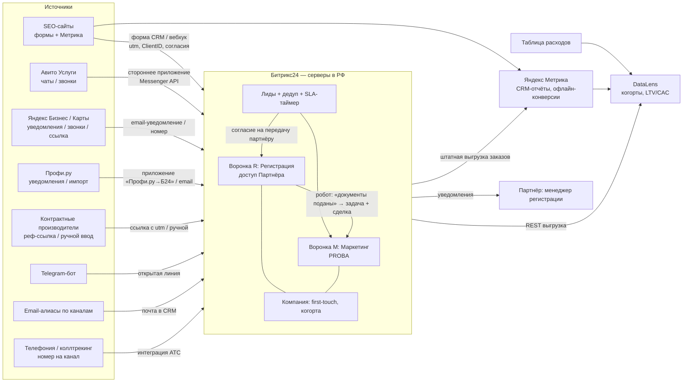

# PROBA LAB — Track F: единая инфраструктура лидогенерации, CRM, атрибуции и комплаенса

Дата составления: 2026-10-23. Автор: research/architecture agent.
Статус: черновик для решения основателя. Не юридическая консультация — разделы по 152-ФЗ и «О рекламе» нужно сверить с юристом и с текстом законов на pravo.gov.ru / consultant.ru.

## 0. Метки и ограничения проверки

| Метка | Значение |
|---|---|
| **[Факт]** (Verified Fact) | Подтверждено официальным источником (сайт вендора/госоргана/закон) — указан URL |
| **[Наблюдение]** (Observation) | Видно в сторонних источниках, СМИ, обзорах интеграторов; не сверено с первоисточником |
| **[Гипотеза]** (Hypothesis) | Логичное предположение, требующее проверки |
| **[Рекомендация]** | Предложение по архитектуре/процессу |

**Важное ограничение этой версии.** В среде исполнения прямой доступ к российским доменам был закрыт сетевым прокси (bitrix24.ru, amocrm.ru, developers.avito.ru, yandex.ru, yandex.cloud, consultant.ru, pravo.gov.ru возвращали отказ соединения, 2026-10-23). Поэтому:
- официальные прайс-страницы **не открыты напрямую**; цены ниже — либо из выдачи поиска по официальной странице (помечено), либо из сторонних обзоров (**[Наблюдение]**, «уточнить»);
- нормы законов подтверждены через вторичные юридические источники (1С:ИТС, buh.ru, Контур, Гарант-подобные порталы) — помечены как [Наблюдение] с высокой согласованностью, кроме случаев, где источники расходятся.
- **Обязательный шаг перед внедрением:** открыть каждый URL из раздела 13 и зафиксировать цену/норму с датой (чек-лист, п. 12).

Дата обращения ко всем источникам: **2026-10-23**.

---

## 1. Резюме (TL;DR)

1. **[Рекомендация] CRM — Битрикс24 (облако, РФ)** как ядро для обеих линий бизнеса (Регистрация с партнёром + Маркетинг). Причины: [Факт] данные облака Битрикс24 хранятся на серверах в РФ (helpdesk.bitrix24.ru/open/7206357); есть официальная выгрузка CRM в Яндекс Метрику (yandex.ru/support/metrica/crm/bitrix.html); пакетная лицензия (не за пользователя) выгоднее при подключении партнёра; роботы/триггеры, несколько воронок, REST/вебхуки, экстранет для внешних пользователей. amoCRM — достойная альтернатива для чисто «чатовых» продаж, но тарификация за пользователя и неподтверждённая (в рамках этого исследования) локализация. **Kommo** — международная версия amoCRM; для лидов граждан РФ не рекомендуется из-за риска первичной записи ПДн вне РФ (ч. 5 ст. 18 152-ФЗ) — [Гипотеза], проверить, где хостится Kommo.
2. **API реальности:** Авито — есть Messenger API (чаты/сообщения), доступ по данным интеграторов только на расширенных/максимальных тарифах Авито; API звонков публично не подтверждён. Яндекс Бизнес — публичного API заявок не найдено, только уведомления/встроенная мини-CRM. Профи.ру — публичного API для специалистов не найдено; есть стороннее приложение «Профи.ру → Битрикс24» (импорт кнопкой). Сайт/Telegram/email — штатно через формы и открытые линии CRM.
3. **Атрибуция:** «клиент» = компания (ИНН) в CRM; first-touch источник пишется **один раз** на Компанию и не перезаписывается; выручка считается только по сделкам, с полями `gross`, `partner_payout`, `net_proba` и `legal_entity`; когорты — по месяцу первого касания. Двойного счёта нет, потому что клиент считается 1 раз (по компании), а выручка — по сделкам.
4. **152-ФЗ (2026):** отдельный документ согласия (с 01.09.2025, 156-ФЗ); уведомление РКН до начала обработки (штраф юрлицу 100–300 тыс. ₽ с 30.05.2025, 420-ФЗ); запрет первичной записи/хранения ПДн граждан РФ в зарубежных БД (с 01.07.2025, 23-ФЗ) → никаких Google Forms/Tilda-заявок в зарубежные хранилища/HubSpot/Kommo как первичной точки; передача лида партнёру — по согласию с указанием партнёра и цели (партнёр — самостоятельный оператор) или поручение по ч. 3 ст. 6; cookie-баннер для Метрики; уведомление о записи звонков; отдельное согласие на рекламные рассылки (ст. 18 ФЗ «О рекламе»).

---

## 2. Контекст и требования

- Две юрлица: **PROBA LAB** (маркетинг/коммерциализация) и **Партнёр** (госрегистрация БАД — СГР, декларирование).
- Каналы лидов: SEO-сайты, Авито Услуги, Яндекс Бизнес/Карты, Профи.ру, контрактные производители (партнёрские рекомендации).
- Команда: основатель + дизайнер-разработчик (part-time) → решения должны быть «настроил и забыл», минимум кастомного кода.
- Цель: каждая заявка — в одной CRM, с источником, SLA, историей коммуникаций; регистрационные лиды → партнёру; кросс-селл в маркетинг; честная атрибуция без двойного счёта; соответствие 152-ФЗ.

---

## 3. Выбор CRM: Битрикс24 vs amoCRM (vs Kommo)

### 3.1 Сравнительная таблица

| Критерий | Битрикс24 (облако, .ru) | amoCRM (.ru) | Kommo (международная) |
|---|---|---|---|
| Модель цены | Пакет на N пользователей | За пользователя/мес | За пользователя/мес (USD) |
| Цена (официально) | **Уточнить** на bitrix24.ru/prices/ (страница не открылась) | **Уточнить** на amocrm.ru/prices | Уточнить на kommo.com/pricing |
| Цена [Наблюдение, сторонние обзоры 2025–2026] | Базовый (5 польз.) ≈ 2 490 ₽/мес; Стандартный (50) ≈ 6 990 ₽/мес; Профессиональный (100) ≈ 13 990 ₽/мес; скидка за год 20–30% (источники расходятся); цены без НДС | Базовый ≈ 599 ₽/польз./мес; Расширенный ≈ 1 099–1 199 ₽; Профессиональный ≈ 1 599–1 699 ₽ (источники расходятся; было повышение в сент. 2025 по данным vc.ru) | — |
| Локализация ПДн в РФ | **[Факт]** серверы в РФ (helpdesk.bitrix24.ru/open/7206357; резерв в Yandex Cloud — yandex.cloud/ru/cases/1c-bitrix) | [Гипотеза] вероятно РФ для .ru-аккаунтов; **официального подтверждения в этом исследовании не найдено — запросить письменно** | [Гипотеза] вне РФ → риск ч. 5 ст. 18 152-ФЗ |
| Несколько воронок | Да (направления сделок); число по тарифу — уточнить | Да; число по тарифу — уточнить | Да |
| Автоматизация | Роботы и триггеры на стадиях; бизнес-процессы на старших тарифах. [Наблюдение] на бесплатном — без БП и внешних интеграций | Digital pipeline, триггеры, Salesbot | То же |
| Внешний партнёр | Экстранет / ограниченные права по направлению воронки — [Гипотеза] проверить на выбранном тарифе | Права по воронкам/пользователю; партнёр = платный пользователь | — |
| API/вебхуки | REST API, входящие/исходящие вебхуки (на платных тарифах — уточнить) | REST API v4, вебхуки | То же |
| Метрика | **[Факт]** штатная выгрузка CRM в Метрику (yandex.ru/support/metrica/crm/bitrix.html) | Через интеграции/виджеты (уточнить) | — |
| Авито | Только сторонние приложения маркетплейса (Radist.Online, Whatcrm, Umnico, asmo и др.) | Сторонние (AVITOMA и др.) | Сторонние |
| Профи.ру | Стороннее приложение «Профи.ру → Битрикс24» | Не найдено | — |
| Telegram/email | Открытые линии (Telegram-бот), почта в CRM | Мессенджеры, почта | То же |

### 3.2 Решение

**[Рекомендация]** Битрикс24, тариф уровня «Базовый» на старт (до 5 пользователей хватает: основатель, дизайнер-разработчик, 1–2 менеджера партнёра), с переходом на «Стандартный» при подключении экстранета/бизнес-процессов/большего числа сотрудников партнёра. Перед покупкой проверить на bitrix24.ru/prices/:
- доступны ли на «Базовом» несколько направлений сделок, роботы, REST/вебхуки, приложения маркетплейса, интеграция с Метрикой;
- как оформить права партнёра (экстранет или обычный пользователь с доступом только к воронке «Регистрация»).

**[Рекомендация]** Kommo не использовать как первичное хранилище лидов граждан РФ. amoCRM рассматривать, если (а) получено письменное подтверждение локализации и (б) основная масса лидов идёт через чаты Авито/мессенджеры.

**[Рекомендация] Альтернатива-партнёр.** Если партнёр по регистрации уже ведёт свою CRM — не заставлять его переезжать; обмен через вебхук «передать лид» + обратный статус (см. §6.3). Но тогда потребуется договор о передаче ПДн и обратная синхронизация статусов (вручную или через API).

---

## 4. Источники лидов и реальность API (по платформам)

| Канал | Что есть официально | Как заводим в CRM | UTM? | Источник/фиксация |
|---|---|---|---|---|
| **SEO-сайты** | Формы, Метрика (цели, ClientID) | Форма CRM Битрикс24 (встраивается на сайт) или вебхук из своей формы → `crm.lead.add` | Да (для органики — `utm` нет, источник из Метрики/referrer) | Скрытые поля: `utm_*`, `_ym_uid` (ClientID), `landing`, `referrer` |
| **Авито Услуги** | [Наблюдение] Avito Messenger API (чтение чатов, отправка сообщений) на developers.avito.ru; доступ, по данным интеграторов, только на расширенных/максимальных тарифах (для услуг — «Расширенный» или «Максимальный»), иначе 403. API статистики звонков публично не подтверждён (vc.ru). [Наблюдение] Avito Pro API для агентств расширен в фев. 2026 (Sostav) | Приложение маркетплейса Битрикс24 (Radist.Online / Whatcrm / Umnico / asmo — все сторонние, платные) → Открытая линия; звонки — вручную или подменный номер коллтрекинга в объявлении (проверить правила Авито о номерах) | **Нет** (ссылки в объявлениях ограничены) | Источник ставится автоматически по каналу открытой линии = `avito`; для звонков — отдельный номер/«Авито-номер» |
| **Яндекс Бизнес / Карты** | [Наблюдение] публичного API заявок не найдено; есть встроенная мини-CRM и уведомления о заявках (workspace.ru) | Уведомления на выделенный email → почтовый коннектор CRM создаёт лид; звонки — выделенный номер в карточке организации | Ссылка на сайт из карточки — **да**, можно поставить UTM (`utm_source=yandex_maps`) | Отдельный номер/email на канал |
| **Профи.ру** | [Наблюдение] публичного API для специалистов не найдено; есть приложение «Профи.ру → Битрикс24» (стороннее: кнопка импорта на странице заказа) и мобильное приложение с уведомлениями | Стороннее приложение или ручной ввод с шаблоном; уведомления — на выделенный email | **Нет** | Источник = `profi` вручную/приложением |
| **Контрактные производители (партнёры-рекомендатели)** | — | Персональная ссылка/форма с `utm_source=partner&utm_campaign=<код>` или промокод; ручной ввод с полем «Рекомендатель» | Да (ссылка) | Поле `referrer_partner` (справочник) |
| **Telegram** | Bot API (официальный Telegram) | Открытая линия Битрикс24 «Telegram» | Через deep-link `?start=<код>` | Код источника в start-параметре |
| **Email** | — | Почтовый ящик в CRM | — | Разные ящики на канал (fallback) |
| **Телефон** | — | Телефония/коллтрекинг → CRM | — | Статический номер на канал / динамический пул на сайте |

**[Гипотеза]** Мессенджеры MAX/WhatsApp: WhatsApp — зарубежный сервис (риски трансграничной передачи), MAX — проверить наличие официального коннектора к выбранной CRM (amoCRM анонсировала интеграцию с MAX на АМОКОНФ 2026 по данным flysk.ru — [Наблюдение]).

---

## 5. Идентификация источника

### 5.1 Иерархия определения источника (по убыванию надёжности)
1. **Технический канал** (открытая линия Авито/Telegram, конкретный email-ящик, конкретный номер) — автоматически.
2. **UTM + ClientID Метрики** из скрытых полей формы (только сайт и ссылки).
3. **Коллтрекинг** (динамический номер на сайте → сессия Метрики).
4. **Ручное поле «Как вы о нас узнали»** (обязательное для менеджера на стадии «Квалифицирован», справочник значений).
5. При конфликте: технический канал > UTM > коллтрекинг > ответ клиента; ответ клиента сохраняем отдельно (`self_reported_source`) — для аналитики «dark social».

### 5.2 UTM-конвенция [Рекомендация]
`utm_source` ∈ {yandex, google, yandex_maps, avito, profi, partner, telegram, email, vk}; `utm_medium` ∈ {organic, cpc, maps, referral, messenger, email}; `utm_campaign` = `<линия>_<кампания>` (`reg_sgr_badd`, `mkt_audit`); `utm_content` = страница/объявление.

### 5.3 Яндекс Метрика
- Цели: отправка формы, клик по телефону/мессенджеру, звонок (из коллтрекинга).
- ClientID (`_ym_uid`) пишем в лид — нужен для офлайн-конверсий.
- **[Факт]** Офлайн-конверсии: загрузка по ClientID/UserID через интерфейс (CSV) или API; цели должны быть созданы заранее; данные появляются в течение 2–3 ч после загрузки (yandex.ru/support/metrica/data/offline-conversion-data.html — версии справки расходятся по сроку).
- **[Факт]** Интеграция с Битрикс24: при первом подключении загружаются все клиенты и заказы, к визитам привязываются заказы за последние 21 день, далее обновление ежечасно; стадии CRM сопоставляются с типами статусов; отчёты «Источники заказов из CRM» и «Источники, расходы и ROI» (yandex.ru/support/metrica/crm/bitrix.html). API импорта заказов/звонков/расходов: yandex.ru/dev/metrika/ru/data-import/.
- **[Рекомендация]** Использовать штатную интеграцию Метрика ↔ Битрикс24 вместо ручного CSV.

### 5.4 Коллтрекинг в РФ

| Провайдер | Публичная цена | Статус |
|---|---|---|
| Calltouch | [Наблюдение] от ≈5 400–6 900 ₽/мес (агрегаторы, расходятся); официального прайса не открыто | Уточнить на calltouch.ru (калькулятор) |
| CoMagic / UIS | [Наблюдение] ВАТС от 1 500 ₽ + номера; сквозная аналитика от 10 000 ₽/мес (toolfox) | Уточнить |
| Roistat | Не найдено | Уточнить |
| Mango Office | [Наблюдение] от 1 600 ₽/мес + трафик (toolfox, данные на 27.06.2026) | Уточнить |
| Callibri | Есть публичная страница тарифов callibri.ru/multitracking/price (не открыта) | Уточнить |

**Динамический пул — последствия [Гипотеза/Рекомендация]:**
- Пул = (визитов в пиковый час × ср. время на сайте) / «время удержания номера»; для B2B-ниши с малым трафиком (сотни визитов/день) достаточно 3–6 номеров, но каждый номер — абонплата.
- Номер «прилипает» к сессии ограниченное время: повторные звонки через недели могут прийти с другого номера или «освободившегося» номера → ошибки атрибуции; лечится дедупликацией по номеру клиента в CRM (first-touch уже записан на контакте/компании).
- На старте трафик мал → **[Рекомендация]** статический коллтрекинг: 1 номер на канал (сайт-SEO, Яндекс Карты, Авито, Профи, партнёры) — дешевле, проще, достаточно для B2B.
- Запись разговоров требует уведомления клиента (см. §10.7).

### 5.5 Fallback-контакты по каналам [Рекомендация]
- Email: `seo@`, `maps@`, `avito@`, `profi@`, `partners@` (алиасы одного ящика, CRM определяет канал по адресу получателя).
- Телефон: статический номер на канал (виртуальная АТС, подключённая к CRM).

---

## 6. Воронки, статусы, маршрутизация, SLA

### 6.1 Сущности
- **Лид** (необработанное обращение) → после квалификации конвертируется в **Компанию + Контакт + Сделку** в нужной воронке.
- [Рекомендация] В Битрикс24 можно включить «простой режим» (без лидов) — но для подсчёта Leads vs Qualified Leads лучше оставить лиды.

### 6.2 Воронки

**Воронка R «Регистрация» (исполнитель — Партнёр):**
`Новая → Квалифицирована → КП отправлено → Договор → Оплата → В работе → Документы поданы → Выполнено (СГР/декларация получены)` + `Проиграна` (причина обязательна).

**Воронка M «Маркетинг» (исполнитель — PROBA LAB):**
`Лид (входящий или кросс-селл) → Аудит (диагностика/аудит готовности к рынку) → КП → Проект (разовый) → Retainer (абонемент)` + `Проиграна`.

**Воронка P «Партнёры-рекомендатели»** (опционально): контрактные производители как источник — для учёта рекомендаций и вознаграждения.

### 6.3 Правила маршрутизации [Рекомендация]

```
Если запрос содержит {СГР, свидетельство о госрегистрации, декларация, ТР ТС/ЕАЭС, регистрация БАД}
  и НЕТ запроса на маркетинг → Воронка R, ответственный = менеджер Партнёра
Если запрос {упаковка, бренд, маркетплейсы, сайт, продвижение, вывод на рынок} → Воронка M, ответственный = PROBA
Если оба → основная сделка в R + связанная сделка в M на стадии «Лид (кросс-селл)»
Неясно → PROBA квалифицирует в течение SLA, затем переносит
```
- **Передача лида партнёру** — только после согласия клиента на передачу ПДн конкретному юрлицу (см. §10.4). В карточке поле `consent_transfer_partner = да/нет, дата, версия текста`.
- Партнёр видит **только** воронку R и связанные контакты (права «по направлению»), без доступа к M и финансам PROBA.

### 6.4 Автоматизация кросс-селла (роботы)
| Триггер | Действие |
|---|---|
| R: «Документы поданы» | Создать сделку в M «Лид (кросс-селл)», связать с компанией, задача PROBA «Предложить аудит готовности к выходу на рынок» срок +2 раб. дня |
| R: «Выполнено» | Задача PROBA «Поздравить + КП на маркетинговый запуск»; письмо клиенту (только если есть согласие на рекламную рассылку; иначе — сервисное сообщение без рекламы) |
| M: «Проект» завершён | Задача «Предложить retainer» через 14 дней |
| Любая сделка «Проиграна» | Обязательное поле «Причина», задача на ре-активацию через 90 дней (если есть согласие на коммуникацию) |
| Новый лид | Задача ответственному «Ответить» со сроком = SLA; эскалация основателю при просрочке |

### 6.5 SLA и измерение
- [Рекомендация] **Первый ответ:** рабочие часы — ≤ 15 мин для чатов (Авито, Telegram), ≤ 1 ч для форм/email; вне рабочего времени — до 11:00 следующего рабочего дня. Регистрационный лид: передача партнёру ≤ 2 ч; партнёр — первый контакт ≤ 4 рабочих часа.
- **Измерение:** `first_response_at − created_at` (в рабочих часах). В CRM — время ответа в открытых линиях (встроенная статистика), для лидов — поле «Дата первого контакта» заполняется роботом при первом исходящем звонке/письме/сообщении или при смене стадии с «Новая»; отчёт: медиана и 90-й перцентиль по каналу и по ответственному (партнёр отдельно).
- Договорной SLA с партнёром (приложение к партнёрскому договору): сроки, штраф/перераспределение лидов при систематической просрочке.

### 6.6 История коммуникаций
Всё в таймлайне сделки/контакта: звонки (запись — при уведомлении), чаты открытых линий, письма, комментарии партнёра. Запрет на ведение клиента «в личном WhatsApp».

### 6.7 Дашборд
- **Старт:** встроенные отчёты CRM (воронка, источники, время ответа) + Метрика «Источники заказов из CRM».
- **Масштаб:** Yandex DataLens поверх выгрузки CRM (REST → таблица/БД) + Метрика (коннектор). [Наблюдение, официальная страница через выдачу поиска] с 01.12.2025 DataLens: 1 рабочее место бесплатно, командная работа — 990 ₽/мес за место (yandex.cloud/ru/blog/yandex-datalens-tariffs-changes; yandex.cloud/ru/docs/datalens/pricing) — уточнить с НДС/без.

---

## 7. Атрибуция без двойного счёта

### 7.1 Принципы
1. **Клиент (customer) = Компания в CRM**, ключ — ИНН (для ИП — ИНН ИП). Физлицо без юрлица — Контакт как «компания из одного человека».
2. **First-touch** (источник первого обращения) записывается **на Компанию один раз** и никогда не перезаписывается роботом (только вручную с комментарием).
3. **Last-touch / источник сделки** пишется на каждую сделку (может отличаться: кросс-селл, повторный заход).
4. **Выручка — только на сделках**, с разделением по юрлицу и на gross/net.
5. **Клиенты считаются по Компании, деньги — по сделкам** → каждая сделка имеет ровно одну компанию; сумма по компаниям = сумма по сделкам; нет двойного счёта клиентов между линиями.
6. Кросс-селл-сделка M получает `deal_origin = cross_sell_from_R` и ссылку на исходную сделку R, но её **маркетинговые затраты не начисляются второй раз** — CAC относится к компании (первому приобретению).

### 7.2 Схема полей

**Компания (UF_ на Компании):**
| Поле | Тип | Пример | Правило |
|---|---|---|---|
| `inn` | строка | 7700000000 | уникальность, дедуп |
| `ft_channel` | список | seo / avito / yandex_maps / profi / partner_cm / telegram / direct | из первого лида, read-only |
| `ft_utm_source/medium/campaign` | строки | yandex / organic / — | из первого лида |
| `ft_ym_client_id` | строка | 1729…| для офлайн-конверсий |
| `ft_date` | дата | 2026-11-05 | дата первого лида |
| `ft_line` | список | registration / marketing | линия первого обращения |
| `cohort_month` | строка | 2026-11 | = месяц `ft_date` |
| `self_reported_source` | список+текст | «посоветовал производитель» | ответ клиента |
| `referrer_partner` | привязка | ООО «КонтрактПроизв» | если рекомендация |
| `first_won_date` | дата | 2026-11-20 | робот при первой выигранной сделке |
| `is_customer` | да/нет | да | ≥1 оплаченная сделка |

**Сделка:**
| Поле | Тип | Пример |
|---|---|---|
| `pipeline` | R / M | R |
| `legal_entity` | Партнёр / PROBA LAB | Партнёр |
| `deal_origin` | inbound / cross_sell_from_R / cross_sell_from_M / repeat | inbound |
| `parent_deal_id` | id | — |
| `deal_channel` | список | seo |
| `gross_amount` | ₽ | 60 000 (сумма счёта клиенту) |
| `vat_included` | да/нет | — |
| `partner_payout` | ₽ | часть, причитающаяся партнёру (если PROBA выставляла счёт) |
| `proba_fee` | ₽ | агентское/реферальное вознаграждение PROBA (если счёт выставлял партнёр) |
| `net_proba_revenue` | ₽ | выручка, признаваемая PROBA |
| `direct_costs` | ₽ | субподряд, госпошлины, лаборатории (если на PROBA) |
| `paid_at` | дата | — |
| `first_response_at` | дата-время | — |
| `lost_reason` | список | — |

**Расходы (вне CRM, таблица/DataLens):** `month, channel, cost_type (ads/platform_fee/calltracking/seo_content/partner_commission), amount`.

### 7.3 Учёт выручки двух компаний (gross vs net)
Две допустимые модели — выбрать и закрепить договором [Рекомендация]:
- **Модель A (рекомендуется для прозрачности):** клиент заключает договор и платит **Партнёру** за регистрацию; PROBA получает от партнёра вознаграждение за рекомендацию (агентский/реферальный договор). В CRM: `legal_entity=Партнёр`, `gross_amount` = счёт партнёра, `proba_fee` = вознаграждение, `net_proba_revenue = proba_fee`.
- **Модель B:** PROBA выставляет счёт клиенту как агент/генподрядчик и перечисляет партнёру его часть. `legal_entity=PROBA LAB`, `gross_amount` = счёт, `partner_payout` = часть партнёра, `net_proba_revenue = gross − partner_payout` (налоговые последствия агентской схемы — к бухгалтеру).

В отчётах всегда два ряда: **Group Gross** (то, что заплатил клиент обеим компаниям — для LTV клиента и ценности канала) и **PROBA Net** (для CAC, маржи, решений PROBA).

### 7.4 Пример расчёта (иллюстрация, цифры условные)

Клиент «БАД-Старт» (ИНН …) пришёл с SEO-статьи 05.11.2026 за СГР (`ft_channel=seo`, `cohort_month=2026-11`).

| Сделка | Воронка | Юрлицо | Gross | Partner payout | PROBA net | Прямые затраты PROBA |
|---|---|---|---|---|---|---|
| D1 СГР | R | Партнёр (модель A) | 60 000 | — | 9 000 (15% реферал) | 0 |
| D2 Аудит готовности | M (cross_sell_from_R) | PROBA | 40 000 | 0 | 40 000 | 0 |
| D3 Проект «упаковка + карточки МП» | M | PROBA | 150 000 | 0 | 150 000 | 30 000 (подрядчик) |
| D4 Retainer 6 мес × 50 000 | M | PROBA | 300 000 | 0 | 300 000 | 60 000 |
| **Итого** | | | **550 000** | | **499 000** | **90 000** |

- В отчёте «по каналам» канал **seo** получает: 1 нового клиента (не 4), Group Gross 550 000, PROBA Net 499 000, валовую прибыль PROBA 409 000.
- Кросс-селл D2–D4 **не** создаёт нового клиента и **не** получает отдельный CAC; в отчёте «по происхождению сделки» видно, что 490 000 из 499 000 net пришли через кросс-селл.
- Если бы клиент потом пришёл повторно через Авито за декларацией (D5), D5 получит `deal_channel=avito`, `deal_origin=repeat`, но компания остаётся в канале **seo** (first-touch) — двойного учёта клиента нет; в last-touch-отчёте D5 видна Авито.

### 7.5 Когортный отчёт
Строки — `cohort_month` (месяц первого касания), столбцы — месяцы с `ft_date` (M0…M12), значения — накопленные PROBA Net и Group Gross на клиента, доля клиентов с ≥1 сделкой M (Cross-Sell Rate), доля с ≥2 оплаченными сделками (Repeat). Разрезы: `ft_channel`, `ft_line`.

---

## 8. Метрики: формулы и источники

Обозначения: период = календарный месяц (если не указано); «клиент» = Компания с ≥1 оплаченной сделкой; net = PROBA Net, gross = Group Gross.

| Метрика | Формула | Источник данных | Две компании |
|---|---|---|---|
| Organic Sessions | Визиты с источником «Поисковые системы» (органика) | Метрика | Только сайты PROBA |
| Leads | Кол-во созданных лидов (после дедупликации по телефону/email/ИНН за 30 дней) | CRM | Все лиды обеих линий; разрез `ft_line` |
| Qualified Leads (QL) | Лиды, достигшие стадии «Квалифицирован» (критерии: целевой продукт БАД/косметика/функц. питание, есть юрлицо/план, есть контакт, понятный запрос) | CRM | Разрез R/M |
| CPL | Расходы канала / Leads канала | Таблица расходов + CRM | Расходы PROBA; если партнёр софинансирует — учитывать только свою долю или обе отдельно |
| Cost per Acquired Customer (CPA клиента) | Расходы канала / новые клиенты канала (first_won в периоде) | Расходы + CRM | Новый клиент считается 1 раз на группу |
| Lead-to-Client | Новые клиенты когорты / Leads когорты (по `ft_date`) | CRM | Когортно, чтобы не смешивать периоды |
| Cross-Sell Rate | Клиенты с выигранной сделкой R **и** ≥1 оплаченной сделкой M / клиенты с выигранной R (в когорте, за окно 6/12 мес) | CRM | Ключевая метрика связки |
| Average Check | Σ gross оплаченных сделок / кол-во оплаченных сделок (отдельно R и M) | CRM | Отдельно по юрлицам; не смешивать |
| Gross Margin | (PROBA Net − прямые затраты) / PROBA Net | CRM + бухучёт | Только PROBA; для R = реферал (почти 100%) |
| Revenue per Customer | Σ net (или gross) / число клиентов когорты | CRM | Указывать какой: net или gross |
| CAC | (маркетинговые + продажные расходы PROBA за период, вкл. долю ФОТ на продажи, коллтрекинг, платформы, SEO-контент) / новые клиенты периода | Бухучёт + CRM | Если партнёр платит часть привлечения — CAC группы и CAC PROBA отдельно |
| Contribution Margin | PROBA Net − прямые затраты − переменные расходы на привлечение/обслуживание (комиссии платформ, вознаграждения рекомендателям) | CRM + учёт | На клиента/когорту/канал |
| Repeat Purchase Rate | Клиенты с ≥2 оплаченными сделками / все клиенты (окно 12 мес) | CRM | Кросс-селл R→M считается повтором для группы; для PROBA — повтор = ≥2 сделки с net>0 |
| LTV | Σ Contribution Margin клиента за горизонт (12/24 мес, факт по когортам); прогноз: ср. CM на клиента в мес × ожидаемая длительность | Когортный отчёт | Решения по каналам — на LTV(net) / CAC(PROBA) |

**[Рекомендация]** Минимальные пороги для решений не устанавливать до набора ≥30 клиентов в когорте/канале — малые выборки.

---

## 9. Архитектура

### 9.1 Диаграмма



### 9.2 Минимальный стек на старт (дёшево)

| Компонент | Решение | Стоимость/мес | Источник |
|---|---|---|---|
| CRM | Битрикс24 «Базовый» (до 5 польз.) | **уточнить**; [Наблюдение] ≈2 490 ₽ без НДС помесячно | bitrix24.ru/prices/ (не открыта) |
| Аналитика сайта | Яндекс Метрика | 0 ₽ [Гипотеза: бесплатна] | metrika.yandex.ru — уточнить |
| CRM↔Метрика | Штатная интеграция | 0 ₽ | yandex.ru/support/metrica/crm/bitrix.html |
| Формы сайта | Формы CRM Битрикс24 / своя форма на российском хостинге + вебхук | 0 ₽ сверх CRM | — |
| Авито-чаты | Стороннее приложение маркетплейса Б24 + тариф Авито с доступом к API | **уточнить** (цены вендоров и тарифа Авито) | bitrix24.ru/apps/app/radist.avito/ и аналоги |
| Профи.ру | Приложение «Профи.ру → Битрикс24» или ручной ввод | **уточнить** | bitrix24.ru/apps/app/ilya_shchennikov.profi_ru_bitriks24/ |
| Телефония | Виртуальная АТС с 4–5 статическими номерами, интеграция с Б24 | **уточнить** | — |
| Дашборд | Отчёты CRM + Метрика; DataLens 1 место | 0 ₽ | yandex.cloud/ru/docs/datalens/pricing ([Наблюдение] через выдачу) |
| Cookie-баннер, согласия | Самописный блок на сайте | 0 ₽ (время разработчика) | — |

Подтверждено официальными цифрами: только DataLens (0 ₽ за 1 место). Остальное — уточнить; ориентир по наблюдениям ≈ 2,5–5 тыс. ₽/мес + телефония + Авито-коннектор.

### 9.3 Стек для масштаба

| Компонент | Решение | Стоимость | Источник |
|---|---|---|---|
| CRM | Битрикс24 «Стандартный»/«Профессиональный» (бизнес-процессы, больше пользователей партнёра) | уточнить; [Наблюдение] ≈6 990 / 13 990 ₽/мес | bitrix24.ru/prices/ |
| Коллтрекинг | Динамический (Calltouch / CoMagic-UIS / Roistat / Mango / Callibri) при ≥ ~100 визитах/день на ключевые страницы | уточнить; [Наблюдение] от ≈1,6–10 тыс. ₽/мес + номера | сайты вендоров |
| BI | DataLens командный | 990 ₽/место/мес ([Наблюдение] офиц. блог через выдачу) | yandex.cloud/ru/blog/yandex-datalens-tariffs-changes |
| ETL | Скрипт REST Б24 → ClickHouse/PostgreSQL на российском облаке или Google-таблица → нет (зарубежное хранение ПДн) | уточнить | — |
| Офлайн-конверсии | Автоматическая загрузка в Метрику (через штатную интеграцию) | 0 ₽ | yandex.ru/dev/metrika/ru/data-import/ |

---

## 10. Персональные данные и реклама (152-ФЗ, ФЗ «О рекламе») — состояние на 2026-10

> Все пункты — [Наблюдение] по вторичным юридическим источникам, согласованным между собой; текст закона в этом исследовании напрямую не открыт. Перед запуском — проверка юристом.

### 10.1 Согласие отдельным документом
- С **01.09.2025** ч. 1 ст. 9 152-ФЗ (в ред. **156-ФЗ от 24.06.2025**): согласие на обработку ПДн оформляется **отдельно** от иной информации/документов, которые подписывает субъект (its.1c.ru/db/content/newscomm/src/495627.htm; buhexpert8.ru/?p=619740). Форма — любая, позволяющая подтвердить получение; содержание — по ч. 4 ст. 9 (оператор, цели, перечень ПДн, действия, срок, порядок отзыва).
- **[Рекомендация]** На формах: отдельный, **не предзаполненный** чекбокс «Даю согласие на обработку ПДн» со ссылкой на **отдельный документ согласия** (не на политику, не на оферту); логировать: дата-время, IP, версия текста, URL формы — в поля лида.
- Три **разных** чекбокса: (1) согласие на обработку ПДн (обязательно); (2) согласие на передачу ПДн Партнёру [название, ИНН] для подготовки КП по регистрации (обязателен только при запросе регистрации); (3) согласие на получение рекламы/рассылок (необязателен).

### 10.2 Уведомление Роскомнадзора
- С 01.09.2022 (266-ФЗ) уведомлять РКН нужно о практически любой обработке, перечень исключений сужен (buh.ru/articles/sbor-personalnykh-dannykh-novye-trebovaniya-dlya-kompaniy-s-1-sentyabrya-2022-goda.html). Подаётся **до начала обработки** (через портал pd.rkn.gov.ru / Госуслуги, ЭП/ЕСИА). Изменения сведений — тоже уведомлением.
- Штраф за неподачу/несвоевременную подачу с **30.05.2025** (420-ФЗ, ст. 13.11 КоАП): граждане 5–10 тыс. ₽, должностные лица и ИП 30–50 тыс. ₽, **юрлица 100–300 тыс. ₽** (buh.ru/news/s-30-maya-shtraf-za-narushenie-sroka-podachi-uvedomleniya-v-roskomnadzor-sostavit-do-300-000-rubley.html).
- **[Рекомендация]** Оба юрлица (PROBA и Партнёр) проверяют наличие в реестре операторов и актуальность сведений (цели «продвижение услуг», категории, трансграничная передача — «нет», место хранения БД — РФ).

### 10.3 Прочие штрафы (с 30.05.2025, 420-ФЗ)
- Обработка без правового основания / не по целям: юрлица 150–300 тыс. ₽ (ранее 60–100 тыс.) (buhexpert8.ru/?p=529794; buh.ru/articles/novye-nakazaniya-…).
- Утечки: оборотные и фиксированные штрафы по объёму (напр., 1–10 тыс. субъектов — юрлица 3–5 млн ₽; повторные — оборотные до 1–3% выручки — источники расходятся в деталях).
- Локализация (ч. 8–9 ст. 13.11): [Наблюдение] до 6 млн ₽ первично, до 18 млн ₽ повторно (h-cons.ru) — уточнить.

### 10.4 Локализация первичного сбора (ч. 5 ст. 18)
- С **01.07.2025** (23-ФЗ от 28.02.2025): запрещено при сборе ПДн граждан РФ осуществлять запись, систематизацию, накопление, хранение, уточнение, извлечение с использованием БД **за пределами РФ** (comnews.ru, 2025-10-13; разъяснение Минцифры № П25-44929 от 12.05.2025 — pravo.ppt.ru/pismo/mincifry-rossii/n-p25-44929-316881).
- Следствия: **нельзя** собирать заявки через Google Forms, Typeform, HubSpot, Kommo (если хостинг вне РФ — проверить), зарубежные no-code (Zapier/Make как промежуточное хранилище), Gmail как первичный ящик заявок. Формы → сразу в российскую CRM/БД.
- Трансграничная передача (ст. 12) — отдельное уведомление РКН до передачи; на старте **не делать** вовсе.

### 10.5 Передача лидов партнёру
- **Поручение обработки (ч. 3 ст. 6):** если Партнёр обрабатывает ПДн **по заданию PROBA и без собственных целей** — договор поручения (перечень ПДн, действий, целей, требования к защите, конфиденциальность); согласие субъекта на поручение требуется, если нет иного основания (h-cons.ru; ppt.ru).
- **Но:** партнёр заключает с клиентом **свой** договор на регистрацию → у него **свои цели** → он **самостоятельный оператор**, это **передача** (распространение/предоставление) третьему лицу. Основание — **отдельное согласие** клиента на передачу ПДн конкретному юрлицу (наименование, ИНН, адрес) для конкретной цели, либо клиент сам обращается к партнёру (тогда передачи нет).
- **[Рекомендация]** Модель: в форме/чате — чекбокс №2 (согласие на передачу Партнёру); в CRM на общем портале обе компании — **два оператора**, у каждого свои цели; договор между ними о совместном использовании CRM и обмене данными (кто чей обработчик в части хранения в CRM, кто отвечает за ответы на запросы субъектов, порядок удаления). «Совместные операторы» в 152-ФЗ прямо не урегулированы как отдельный институт — [Гипотеза], обсудить с юристом; ст. 3 упоминает «совместно с другими лицами» в определении оператора.
- Владелец портала Битрикс24 — одна сторона (PROBA); для Партнёра — поручение PROBA хранить его клиентскую базу (обработчик) + отдельный доступ.

### 10.6 Cookies и Яндекс Метрика
- [Наблюдение] Позиция практиков и, по их словам, РКН и судов: cookie/ClientID, позволяющие выделить пользователя, — ПДн; для аналитических и рекламных cookie нужно согласие, технические — без него (ppt.ru/columns/jurist-v-it/kuki-i-personalnye-dannye-chto-trebuet-152-fz; lpmotor.ru/articles/152-fz-cookie-2511).
- **[Рекомендация]** Cookie-баннер с выбором «Только необходимые / Принять аналитику»; Метрика загружается **после** согласия (или с ограничением, если отказ); текст про Метрику и opt-out в политике.
- Встречается утверждение, что сбор Метрикой идёт «на серверах вне РФ» (lpmotor) — **не подтверждено**; Яндекс — российская компания; [Гипотеза] данные в РФ — запросить/найти официальное заявление Яндекса.
- Влияние на атрибуцию: без согласия нет ClientID → растёт доля «неизвестно» — компенсировать каналами-номерами/email и полем «как узнали».

### 10.7 Запись звонков
- [Наблюдение] Запись допустима при уведомлении клиента (автоинформатор в начале звонка) и надёжном хранении (kontur.ru/articles/6373). Голос как **биометрия** (ст. 11) — только если используется для идентификации; простая запись разговора — обычные ПДн, нужна правовая основа и уведомление.
- [Рекомендация] Автоинформатор «Разговор может быть записан для контроля качества…», срок хранения записей — 6–12 мес, в политике — пункт о записи; при коллтрекинге — номер звонящего = ПДн.

### 10.8 Сроки хранения [Рекомендация]
- Лиды без сделки: 12 мес с последнего контакта (или до отзыва согласия) → обезличивание/удаление.
- Клиенты: срок договора + сроки по налоговому/бухучёту для первичных документов (5 лет — для бухгалтерских документов, уточнить у бухгалтера) — данные в договорах хранятся на основании закона, а не согласия.
- Записи звонков: 6–12 мес. Логи согласий: весь срок обработки + 3 года (для доказывания) — [Гипотеза], согласовать с юристом.
- Отзыв согласия: прекратить обработку и уничтожить в срок по ст. 21 (проверить текущий срок, обычно 30 дней) — процесс-регламент.

### 10.9 Политика обработки ПДн (ч. 2 ст. 18.1)
Опубликована на каждом сайте и в каждом месте сбора (ссылка у формы, в автоответе Telegram/Авито — по возможности); содержит: оператор (юрлицо, ИНН, адрес), цели, категории ПДн и субъектов, правовые основания, перечень действий, сроки, порядок уничтожения, передача третьим лицам (Партнёр — название), использование Метрики/cookies, запись звонков, права субъекта, контакты. **У каждого юрлица — своя политика.**

### 10.10 ФЗ «О рекламе»
- Ст. 18 ч. 1: реклама по сетям электросвязи (email, SMS, мессенджеры, звонки) — **только с предварительного согласия**; бремя доказывания — на рекламораспространителе; объединённая «галочка» не признаётся надлежащим согласием (consultant.ru/law/podborki/reklama_bez_soglasiya/; h-cons.ru). Штраф юрлицам по ст. 14.3 КоАП — [Наблюдение] 100–500 тыс. ₽, сверить.
- [Рекомендация] Сервисные письма (ответ на заявку, КП по запросу, статус регистрации) — не реклама; предложение аудита после регистрации — **реклама/предложение услуг**, отправлять только при согласии №3 или в рамках живого диалога по инициативе клиента (граница — к юристу).
- С **01.09.2025** (479-ФЗ и смежный закон): запрет рекламы на ресурсах, доступ к которым ограничен (Instagram и др. Meta), и на ресурсах иноагентов/нежелательных организаций; ответственность — и рекламодателя, и распространителя; юрлица до 500 тыс. ₽ ([Наблюдение] 3dnews.ru/1124721; sostav.ru). Для PROBA: **не заказывать** рекламу у блогеров в Instagram/на ресурсах иноагентов, и не размещать свою рекламу там.
- Маркировка интернет-рекламы (erid, ОРД) — для платной рекламы и партнёрских публикаций — проверить отдельно (не входило в объём проверки).

---

## 11. Прозрачность «две компании»

[Рекомендация]
1. **В формах:** «Регистрацию БАД (СГР, декларирование) выполняет ООО «[Партнёр]», ИНН …; маркетинговые услуги — ООО/ИП «PROBA LAB», ИНН …». Чекбокс согласия на передачу ПДн партнёру с его реквизитами.
2. **На сайте:** страница «Кто оказывает услуги» с реквизитами обоих юрлиц, ссылки на обе политики ПДн.
3. **Договоры и счета:** раздельно — регистрация: договор и счёт от Партнёра; маркетинг: договор и счёт от PROBA. При модели B (агентская) — явно указать, что PROBA действует как агент, и раскрыть исполнителя.
4. **Коммуникации:** подпись менеджера партнёра с названием его компании; КП с логотипом/реквизитами исполнителя.
5. **В CRM:** поле `legal_entity` на каждой сделке обязательно, шаблоны документов привязаны к юрлицу.
6. Реферальное вознаграждение PROBA от партнёра — не скрывать при прямом вопросе клиента; [Гипотеза] обсудить с юристом, требуется ли раскрытие.

---

## 12. Чек-лист внедрения

**Неделя 0 — проверки (без регистрации аккаунтов в этом исследовании)**
- [ ] Открыть bitrix24.ru/prices/ и amocrm.ru/prices, зафиксировать цены и функции тарифов на дату; скриншот в папку `financial/`.
- [ ] Запросить у amoCRM письменно: место хранения данных .ru-аккаунтов; у Kommo — юрисдикция хостинга.
- [ ] Открыть developers.avito.ru: условия доступа к Messenger API для категории «Услуги», наличие вебхуков, API звонков; правила размещения сторонних номеров.
- [ ] Проверить Яндекс Бизнес: есть ли выгрузка/уведомления заявок на email/в Telegram.
- [ ] Получить прайсы коллтрекинга (Calltouch, CoMagic/UIS, Roistat, Mango, Callibri) со страниц тарифов.
- [ ] Юрист: проверка §10 (тексты ст. 9, 18, 22 152-ФЗ, ст. 13.11 КоАП, ст. 18 и 5 ФЗ «О рекламе»).

**Неделя 1 — юридический фундамент**
- [ ] Уведомления РКН (PROBA и Партнёр) — подать/актуализировать.
- [ ] Документы: политика ПДн ×2, отдельный документ согласия на обработку, согласие на передачу Партнёру, согласие на рекламную рассылку, cookie-политика.
- [ ] Договор PROBA ↔ Партнёр: передача лидов, SLA, вознаграждение, совместное использование CRM / поручение, ответственность за утечки.
- [ ] Удалить зарубежные формы/хранилища заявок (Google Forms, зарубежные no-code).

**Неделя 2 — CRM**
- [ ] Купить тариф Б24 (после проверки функций); направления R и M; стадии по §6.2; пользовательские поля по §7.2.
- [ ] Права: Партнёр — только R; PROBA — всё.
- [ ] Дедупликация по телефону/email/ИНН; обязательные поля на стадиях (источник, причина проигрыша, юрлицо).
- [ ] Роботы: SLA-задачи, эскалация, кросс-селл (§6.4), запись `first_response_at`, `first_won_date`, защита `ft_*` от перезаписи.

**Неделя 3 — каналы**
- [ ] Формы сайта: скрытые поля utm/ClientID/landing; три чекбокса; лог согласий.
- [ ] Cookie-баннер; Метрика после согласия; цели.
- [ ] Email-алиасы по каналам → CRM; телефония: номер на канал, автоинформатор о записи.
- [ ] Авито: тариф с API + приложение-коннектор; Профи.ру: приложение или регламент ручного ввода; Telegram-бот → открытая линия.
- [ ] Ссылки с UTM в карточке Яндекс Бизнеса и у партнёров-производителей.

**Неделя 4 — аналитика**
- [ ] Интеграция Метрика ↔ Битрикс24 (сопоставление стадий со статусами заказов).
- [ ] Таблица расходов по каналам (российское хранилище).
- [ ] Отчёты: воронка R/M, источники (first-touch и last-touch), SLA (медиана/P90), когорты; DataLens при ≥3 мес данных.
- [ ] Ежемесячный ритуал: сверка выручки CRM с бухгалтерией (gross/net по юрлицам).

---

## 13. Источники (дата обращения 2026-10-23)

Прямое открытие страниц было недоступно (сетевые ограничения среды); данные получены через поисковую выдачу по указанным URL.

**CRM**
- Битрикс24, тарифы (официальная, не открыта): https://www.bitrix24.ru/prices/ ; https://www.bitrix24.ru/prices/cloud_subscription.php
- Битрикс24, хранение данных в РФ: https://helpdesk.bitrix24.ru/open/7206357
- Битрикс24, лимиты хранилища (17.08.2026): https://www.bitrix24.ru/blogs/novye-limity-oblachnogo-khranilishcha.php
- 1С-Битрикс в Yandex Cloud: https://yandex.cloud/ru/cases/1c-bitrix
- Сторонние обзоры цен Б24 [Наблюдение]: https://autobit24.ru/blog/tarify-bitrix24-dlya-malogo-biznesa-2026/ ; https://integrator.nota.media/blog/articles/tarify-bitriks24-sravnenie-tseny-rekomendatsii/ ; https://vc.ru/id5734114/2773135-bitrix24-stoimost-bazovogo-tarifa
- amoCRM тарифы (официальная, не открыта): https://www.amocrm.ru/prices
- Сторонние обзоры цен amoCRM [Наблюдение]: https://luckru.ru/amocrm/tseny-na-tarify-amocrm/ ; https://flysk.ru/blog/amocrm-2026-amma-relize-amokonf ; https://delomatika.ru/kupit-amocrm-sravnenie-tarifov/ ; https://vc.ru/services/2762746-amocrm-2026-vysokaya-tsena-voronki-prodazh
- Kommo (не открыта): https://www.kommo.com/pricing/

**Платформы**
- Авито API (не открыта): https://developers.avito.ru/api-catalog
- Интеграторы Авито [Наблюдение]: https://docs.radist.online/en/our-products/connections/avito/ ; https://www.bitrix24.ru/apps/app/radist.avito/ ; https://www.bitrix24.ru/apps/app/telphin.avito_ot_whatcrm/ ; https://umnico.com/ru/help/avito-bitrix24/ ; https://anythingmcp.com/guides/avito-to-mcp
- Авито звонки по API [Наблюдение]: https://vc.ru/780096-test-avito-dlya-b2b-tipografii ; Avito Pro API для агентств: https://www.sostav.ru/publication/avito-rasshiril-funktsionalnost-api-dlya-reklamnykh-agentstv-81942.html
- Яндекс Бизнес [Наблюдение]: https://workspace.ru/blog/obzor-yandeks-biznesa/
- Профи.ру → Битрикс24: https://www.bitrix24.ru/apps/app/ilya_shchennikov.profi_ru_bitriks24/

**Метрика, BI, коллтрекинг**
- Офлайн-конверсии: https://yandex.ru/support/metrica/data/offline-conversion-data.html
- Метрика ↔ Битрикс24: https://yandex.ru/support/metrica/crm/bitrix.html
- API импорта данных: https://yandex.ru/dev/metrika/ru/data-import/
- DataLens тарифы: https://yandex.cloud/ru/docs/datalens/pricing ; https://yandex.cloud/ru/blog/yandex-datalens-tariffs-changes
- Коллтрекинг [Наблюдение]: https://toolfox.ru/services/s/calltouch ; https://toolfox.ru/services/s/mango-office/alternatives ; https://callibri.ru/multitracking/price ; https://timeweb.com/ru/community/articles/obzor-servisov-kolltrekinga

**Право**
- 156-ФЗ, отдельное согласие с 01.09.2025: https://its.1c.ru/db/content/newscomm/src/495627.htm ; https://buhexpert8.ru/?p=619740
- 420-ФЗ, штрафы с 30.05.2025: https://buh.ru/news/s-30-maya-shtraf-za-narushenie-sroka-podachi-uvedomleniya-v-roskomnadzor-sostavit-do-300-000-rubley.html ; https://buhexpert8.ru/?p=529794 ; https://its.1c.ru/db/content/newscomm/src/492796.htm
- 266-ФЗ, уведомление РКН: https://buh.ru/articles/sbor-personalnykh-dannykh-novye-trebovaniya-dlya-kompaniy-s-1-sentyabrya-2022-goda.html
- 23-ФЗ, локализация с 01.07.2025: https://www.comnews.ru/digital-economy/content/241730/2025-10-13/2025-w42/1016/granica-zamke-osobennosti-raboty-personalnymi-dannymi-rossii ; https://pravo.ppt.ru/pismo/mincifry-rossii/n-p25-44929-316881 ; https://h-cons.ru/stati/lokalizaciya-personalnyh-dannyh-chto-eto-takoe-i-zachem-ona-nuzhna
- Поручение обработки: https://h-cons.ru/stati/poruchenie-na-obrabotku-personalnyh-dannyh-komu-mozhno-poruchit-kak-oformit-dogovor-i-kto-neset-otvetstvennost ; https://ppt.ru/question/personal-data/nado-li-poluchit-soglasie-na-peredachu-personalnykh-dannykh
- Cookies: https://ppt.ru/columns/jurist-v-it/kuki-i-personalnye-dannye-chto-trebuet-152-fz ; https://lpmotor.ru/articles/152-fz-cookie-2511
- Запись звонков: https://kontur.ru/articles/6373
- ФЗ «О рекламе», ст. 18: https://www.consultant.ru/law/podborki/reklama_bez_soglasiya/ ; https://h-cons.ru/stati/soglasie-na-poluchenie-reklamnoj-rassylki-kak-oformit-i-ne-poluchit-shtraf
- Запрет рекламы на запрещённых ресурсах с 01.09.2025: https://3dnews.ru/1124721 ; https://www.sostav.ru/publication/zapret-reklamy-v-instagram-i-navyazyvaniya-uslug-chto-izmenitsya-1-sentyabrya-2025-goda-77774.html ; https://t-j.ru/ads-ban/
