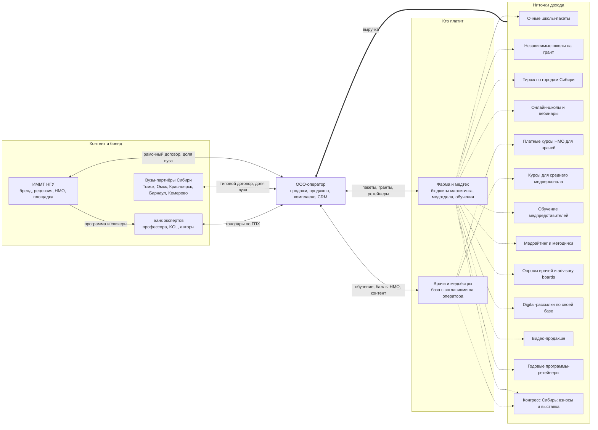

# Бизнес-модель и дорожная карта: оператор университетских школ для врачей Сибири

> Основа: исследование аналогов (`01_Аналоги_мир_и_Россия.md`), первый продукт — Школа ИММТ НГУ «Защита и заживление» (`../01_Школа_гинекологии_BBraun/`).
> Все денежные цифры — **оценки** на 2026–2030 годы, без НДС, если не сказано иное. Налоговые нормы и статус законопроектов перед решениями сверить с бухгалтером и юристом.

---

## 1. Суть бизнеса одной фразой

**Компания-оператор, которая под брендом НГУ и других вузов Сибири производит для фармы и медтеха готовые образовательные пакеты для врачей «под ключ» (школа + материалы + видео + аналитика), а на этой основе строит собственную базу врачей и платные продукты для них.**

Ваш капитал — не школы, а три актива: **договор с университетами, банк экспертов и база врачей с согласиями**. Школы — способ их нарастить и при этом зарабатывать.

### Позиционирование: чем вы отличаетесь

| Конкурент | Что у него есть | Чего нет и где вы сильнее |
|---|---|---|
| **StatusPraesens** (гинекология, Москва) | Бренд, журнал, научный лидер, конгрессы федерального масштаба | Нет университетского бренда в Сибири; дорого для региональных бюджетов; ориентирован на большие залы, а не на школы на 40 человек |
| **Конгресс-операторы** (event-агентства) | Логистика, площадки, выставки | Нет научной рецензии вуза, нет методички, видео и аналитики «в пакете», контент делает заказчик |
| **Онлайн-НМО** («Актион Медицина», «Медзнания», Univadis) | Масштаб, B2C, баллы НМО | Нет очного контакта, нет региональных KOL, фарма не получает живую аудиторию в своём регионе |
| **Сам вуз** (кафедра проводит школу) | Бренд и эксперты | Нет продаж, продакшна, аналитики и скорости; фарме неудобно контрактоваться с вузом |

**Формула отличия:** университетский бренд + регион Сибирь (шесть городов-миллионников и вузов в одной логистике) + пакет «школа + методичка + видео + аналитика» + комплаенс-чистая схема, которую одобрит юрист фармкомпании с первого раза.

---

## 2. Схема бизнеса

---

## 3. Ниточки дохода

Пометки: **П** — повторяющаяся выручка (ретейнер, подписка, ежегодное событие); **К** — растит капитализацию (база, платформа, бренд, договоры, которые остаются в компании при продаже).

| # | Направление | Кто платит | Этап запуска | Чек (оценка) | Маржа после прямых затрат | Что нужно для запуска | Зависимость от фармы | П / К |
|---|---|---|---|---|---|---|---|---|
| 1 | **Очные школы-пакеты** (мероприятие компании: спонсор платит и получает права на видео, аналитику) | Фарма/медтех | 0 — сейчас | 0,9–1,2 млн ₽ | 30–35% | Готово: продукт B. Braun как шаблон | Высокая | — / К (кейсы) |
| 2 | **Независимые школы на образовательный грант** (грант вузу, программу и спикеров определяет кафедра, спонсор — только в раскрытии) | Фарма/медтех через грант НГУ | 1 | 0,8–1,5 млн ₽ | 25–30% (часть остаётся вузу) | Положение НГУ о грантах, договор «вуз — оператор» на услуги | Высокая, но устойчивее к комплаенсу | — / К |
| 3 | **Тираж в другие города и вузы** (Томск, Омск, Красноярск, Барнаул, Кемерово) | Фарма/медтех | 1–2 | 0,8–1,0 млн ₽ за город; пакет «тур по 4 городам» 3,5–4 млн | 38–45% (контент уже есть) | Договор с 1–2 вузами, местные координаторы | Высокая | П (туры) / К |
| 4 | **Онлайн-школы и вебинары** (запись очной школы + живой эфир) | Фарма/медтех | 1 | 0,25–0,5 млн ₽ | 50–60% | Студия/подрядчик, платформа, база для приглашения | Высокая | — / К |
| 5 | **Платные курсы НМО для врачей (B2C)** | Врачи, частные клиники | 2 | 2–6 тыс. ₽ за слушателя | 40–50% (с маркетингом) | Лицензия НГУ или своя лицензия на ДПО, LMS, контент из школ | Нет | П / **К** |
| 6 | **Курсы для среднего медперсонала** (уход за ранами, асептика, стомы) | Клиники, медсёстры, частично медтех | 2 | 1,5–3 тыс. ₽/чел.; корпоративный заказ 150–300 тыс. ₽ | 40–50% | Методист, сотрудничество с колледжами | Низкая | П / К |
| 7 | **Обучение медпредставителей** (клиническая база по нозологии от профессоров НГУ) | Фарма (HR/обучение) | 1 | 0,3–0,6 млн ₽ за модуль | 55% | Программа на 1–2 дня, профессор-лектор | Средняя (другой бюджет) | П / — |
| 8 | **Медрайтинг и методички по заказу** | Фарма (медотдел) | 1 | 0,3–0,6 млн ₽ | 50–55% | Научный редактор-врач, рецензия кафедры | Средняя | — / — |
| 9 | **Опросы врачей, advisory boards, маркетинговые панели** | Фарма (маркетинг, медотдел) | 2 | 0,4–1,0 млн ₽ | 45–55% | База с согласиями, анкеты, аналитик | Средняя | П / **К** |
| 10 | **Digital-рассылки и коммуникации по своей базе** (только с согласиями) | Фарма | 2–3 | 0,2–0,5 млн ₽ за кампанию | 65–75% | 3 000+ контактов с согласиями, CRM, контент-редактор | Высокая | П / **К** |
| 11 | **Видео-продакшн** (дополнительные ролики, экспертные интервью) | Фарма | 1 | 0,1–0,3 млн ₽ | 35–40% | Подрядчик-видеостудия | Высокая | — / — |
| 12 | **Годовые программы-циклы (ретейнер)**: 4–6 школ + онлайн + аналитика по одной нозологии на год | Фарма | 2 | 4–8 млн ₽/год | как у 1+4 | 2–3 успешных кейса, KPI-отчёт | Высокая | **П** / **К** |
| 13 | **Ежегодный конгресс «Сибирь»** (регистрационные взносы + выставка + симпозиумы) | Врачи + фарма | 3 | 10–25 млн ₽ за событие | 25–35% | Бренд, 3 000+ врачей в базе, 2 года школ, комитет из профессоров вузов | Средняя (взносы снижают) | **П** / **К** |

**Вывод по портфелю.** Пп. 1, 3, 4, 7, 8 — деньги первого года, на них живёт компания. Пп. 5, 9, 10, 12, 13 — то, что превращает «агентство» в «актив»: повторяющаяся выручка и база, за которую покупатель платит мультипликатор 5–6x, а не 3x.

---

## 4. Экономика одной школы (оценка, пакет 1,0 млн ₽)

| Статья | ₽ |
|---|---|
| Гонорары 3 профессорам (ГПХ, ~50 тыс.) + страховые взносы 30% | 195 000 |
| Доля НГУ: бренд, рецензия, площадка, оформление НМО (15%) | 150 000 |
| Кейтеринг, раздатка, оформление зала | 60 000 |
| Методичка: автор, вёрстка, печать | 120 000 |
| Видеосъёмка и монтаж | 80 000 |
| Приглашение врачей, логистика, координатор на площадке | 50 000 |
| Анкеты, аналитика, CRM | 20 000 |
| **Прямые затраты** | **675 000** |
| **Маржинальный доход оператора** | **≈325 000 (32,5%)** |

Повтор той же школы в другом городе: методичка и видео уже есть, добавляются переезды профессоров — маржа **38–45%**. Именно поэтому тираж важнее новизны.

**Цена.** Поднимать до **1,0–1,1 млн ₽** не «строкой операционный партнёр», а сменой схемы: договор со спонсором заключает ваше ООО, НГУ получает фиксированную долю за бренд и научную часть. Так ваш доход — не «20% от вуза», а вся маржа за вычетом доли вуза, а вуз освобождается от неудобной для него коммерческой работы.

---

## 5. Юридическая конструкция и доли

### 5.1. Почему ООО, а не ИП/самозанятость
- **Самозанятость** — потолок 2,4 млн ₽/год, нельзя нанимать — не подходит уже на 3-й школе.
- **ИП** годится как временный мост, но: его нельзя продать, в него нельзя ввести директора с долей, фармкомпании и вузы охотнее контрактуются с юрлицом, а ответственность — всем личным имуществом.
- **ООО** — единственная форма, где доля = актив, который можно разделить с директором, заложить в опцион и продать через 5 лет.

**Налоговый режим (решить с бухгалтером).** Ориентир — УСН «доходы минус расходы» 15%: прямые затраты (гонорары, площадки, доля вуза) велики, «доходы 6%» невыгодны. С 2026 года плательщики УСН с выручкой выше 20 млн ₽ (2027 — 15 млн, 2028 — 10 млн) — плательщики НДС (льготные 5/7% без вычета или общая ставка с вычетами) — *проверить актуальные пороги*. Для B2B-клиентов-фармы НДС с вычетом часто удобнее, поэтому при выручке 60+ млн ₽ рассмотреть ОСНО (налог на прибыль 25%). Модель ниже посчитана на УСН 15%.

### 5.2. Рамочный договор с НГУ — что зафиксировать
1. **Предмет:** совместная реализация образовательных программ ИММТ НГУ; оператор — продажи, организация, продакшн; НГУ — научная часть, рецензия, НМО, бренд.
2. **Доля вуза:** фиксированная ставка (10–15% от цены пакета или фикс за мероприятие), расчёт в течение 10 дней после оплаты клиентом.
3. **Право на бренд:** использование логотипа и формулы «Школа ИММТ НГУ» по согласованному брендбуку.
4. **Приоритет / эксклюзив:** оператор — приоритетный партнёр ИММТ по коммерческим образовательным проектам с участием фармы на 3 года с пролонгацией; эксклюзив на Сибирь — хотя бы по направлениям, которые вы открыли.
5. **Научная независимость:** программу и спикеров утверждает кафедра/Центр ПДО — это ваше комплаенс-преимущество, а не ограничение.
6. **Права на результаты:** методички — у НГУ (рецензия), видео — у спонсора или оператора по договору; **база слушателей — у оператора** (согласие на обработку ПДн оператором, НГУ — отдельно).
7. **НМО:** порядок подачи заявок на аккредитацию мероприятий от имени НГУ, сроки.
8. **Порядок выхода:** при расторжении действующие проекты доводятся до конца; оператор сохраняет базу и бренд своей компании.
9. **Ключевое лицо:** проф. Сергеева — куратор со стороны НГУ; прописать, что договор переживает смену куратора (институциональная, а не личная договорённость).

### 5.3. Ваша доля и доля директора
- **Вы — 100% на старте.** Партнёров «на будущее» не вводить.
- **Наёмный директор** (этап 2) — три уровня мотивации:
  1. **Оклад + бонус 10% от EBITDA** сверх плана — с первого дня.
  2. **Фантомная доля 5–10%** (выплаты, равные дивидендам на эту долю, без регистрации в ЕГРЮЛ) — с 1-го года работы.
  3. **Опцион на реальную долю до 10–15%** (опционный договор, ст. 429.2 ГК РФ, + корпоративный договор): вестинг 4 года, **клифф 12 месяцев**, 25% в год; ускорение при продаже компании; good leaver / bad leaver (при уходе с клиентами — выкуп доли по номиналу и штраф по корпоративному договору).
- **Целевая структура к 3-му году:** вы 70–75%, директор до 10–15%, резерв 10–15% под второго ключевого человека (научный руководитель/коммерческий директор) или под вуз-партнёр, если он захочет войти.

### 5.4. Конфликт интересов с работодателем — риск №1

Вы — региональный представитель фармы/медтеха и одновременно продаёте фарме образовательные пакеты. Если работодатель — B. Braun, конфликт **прямой**: сотрудник получает деньги от собственного работодателя через свою компанию. Это классический кейс расследования комплаенса, увольнения «по статье» и запрета на работу с компанией в будущем. Если работодатель — другая компания, конфликт **косвенный**: доступ к врачам и KOL, полученный по работе, и возможная конкуренция с продуктами работодателя.

**Варианты (честно):**

| Вариант | Что делать | Плюсы | Минусы |
|---|---|---|---|
| **А. Раскрыть и получить письменное согласие** | Уведомить комплаенс работодателя о стороннем бизнесе, исключить работодателя и его прямых конкурентов из клиентов, учредитель — вы, директор — другое лицо | Сохраняется доход по найму на старте | Часто не дают согласие; исключение конкурентов сужает рынок |
| **Б. Уйти из найма до первой продажи «своему» работодателю** | Если первая школа — для вашего работодателя, договор с ним подписывается только после увольнения и периода «охлаждения» (обычно 3–6 мес. по политике компании) | Чисто; B. Braun остаётся клиентом | Нет зарплаты до выхода бизнеса на окупаемость |
| **В. Отдать первую школу НГУ «как есть»** | Школу B. Braun проводит НГУ напрямую по текущей смете 800 тыс., вы — без денег и без подписи; ООО начинает работать с другими компаниями после выхода из найма | Нулевой риск, кейс остаётся у вуза и у вас в портфолио | Теряете ~200–300 тыс. на первой школе |
| **Г. Номинальный учредитель/директор** | Оформить ООО на родственника | — | **Не рекомендуется**: комплаенс фармы это находит; это ровно то, за что увольняют и вносят в «чёрные списки» |

**Рекомендация:** сочетание **В + Б**. Первая школа B. Braun — продукт НГУ (кейс и витрина), параллельно регистрируете ООО и готовите пул клиентов вне сферы работодателя. Увольнение — когда подписаны 2–3 договора с другими компаниями или накоплена «подушка» на 6 месяцев. Плюс: **не использовать** базы, CRM, данные о врачах работодателя — только новые контакты с согласиями на ваше ООО.

---

## 6. Оргструктура по этапам

Зарплаты — ориентир по Новосибирску на 2026 год, на руки ≈ оклад − 13% НДФЛ; к ФОТ добавляйте ~30% страховых взносов.

| Этап | Срок | Состав | ФОТ в месяц (оценка) | Ваша роль |
|---|---|---|---|---|
| **0. Вы + НГУ** | 0–6 мес. | Вы; бухгалтер на аутсорсе (25–40 тыс.); подрядчики: видео, верстка, кейтеринг | — | Всё: продажи, организация, площадка |
| **1. + координатор** | 6–12 мес. | PM-координатор мероприятий (90–110 тыс.); научный редактор-врач на 0,5 ставки (60–70 тыс.); юрист по задачам | ~170 тыс. | Продажи, переговоры с вузами, контроль качества |
| **2. Наёмный директор + команда 5–7** | 2-й год | Директор / аккаунт-директор (220–300 тыс. + бонус); 2 PM (100–120 тыс.); научный редактор-врач (110–130 тыс.); координатор KOL и вузов (80–90 тыс.); CRM/digital-аналитик (100–130 тыс.) | 0,75–0,9 млн | Стратегия, топ-клиенты, вузы, новые направления; 2–3 дня в неделю |
| **3. Филиалы / вузы-партнёры** | 3-й год+ | + 3 региональных координатора (Томск, Омск, Красноярск, 60–80 тыс.); методист НМО (90–110 тыс.); аккаунт-менеджер (120–150 тыс. + %); 2-й научный редактор; 3-й PM | 1,7–2,0 млн | Председатель/владелец: стратегия, M&A, ключевые отношения |

**Что держать на аутсорсе всегда:** бухгалтерия, юрист/комплаенс-аудит, видеопродакшн, кейтеринг, печать, LMS-платформа (аренда, не разработка).

**Порядок найма директора:** нанимать, когда поток ≥ 2 школ в месяц стабильно 3 месяца подряд и есть ≥ 3 повторных клиента. Искать среди бывших руководителей медицинских event-агентств или региональных менеджеров фармы с опытом бюджетов — не среди «просто ивентщиков».

---

## 7. Финансовая модель на 3 года (+ ориентир на 4-й год)

### 7.1. Допущения
- Год 1 = первые 12 месяцев после регистрации ООО (≈ 2027).
- Цены без НДС, маржи — из раздела 3; накладные — ФОТ из раздела 6 + офис, ПО, маркетинг, поездки, аутсорс.
- Ваша зарплата как сотрудника ООО (генеральный директор на этапе 0–1, затем председатель/директор по развитию): 200 / 250 / 300 тыс. ₽ в месяц — учтена в расходах.
- Директору — бонус 10% от EBITDA со 2-го года.
- Налог — УСН 15% от (доходы − расходы); на дивиденды направляется 90% чистой прибыли (10% — резерв).
- НДФЛ с дивидендов: 13% до 2,4 млн ₽ в год, 15% сверх.

### 7.2. Продукты по годам

| Продукт | Год 1 | Год 2 | Год 3 | Год 4 (ориентир) |
|---|---|---|---|---|
| Очные школы (пакеты + гранты + тираж), шт. | 16 | 32 | 50 | 65 |
| Средний чек школы, млн ₽ | 1,0 | 1,05 | 1,1 | 1,15 |
| Онлайн-школы / вебинары, шт. | 10 | 24 | 40 | 55 |
| Слушатели платных курсов НМО (B2C) | — | 1 500 | 4 000 | 7 000 |
| Медрайтинг / методички, проектов | 4 | 8 | 12 | 15 |
| Обучение медпредов, модулей | 3 | 6 | 10 | 14 |
| Опросы / advisory boards, проектов | — | 6 | 12 | 18 |
| Конгресс «Сибирь» | — | — | 1 (15 млн) | 1 (22 млн) |

### 7.3. Финансы, млн ₽ (оценка)

| Показатель | Год 1 | Год 2 | Год 3 | Год 4 (ориентир) |
|---|---|---|---|---|
| **Выручка** | **22,2** | **60,5** | **129,3** | **191,7** |
| в т.ч. очные школы | 16,0 | 33,6 | 55,0 | 74,8 |
| в т.ч. онлайн | 3,0 | 8,4 | 16,0 | 24,8 |
| в т.ч. B2C (НМО + медперсонал) | — | 6,0 | 18,0 | 30,5 |
| в т.ч. исследования, медрайтинг, медпреды, digital, видео | 3,2 | 12,5 | 25,3 | 39,7 |
| в т.ч. конгресс | — | — | 15,0 | 22,0 |
| Маржинальный доход | 8,9 | 25,9 | 54,7 | 82,3 |
| Накладные (ФОТ команды, ваша зарплата, офис, маркетинг, аутсорс) | 7,9 | 19,4 | 39,7 | 54,7 |
| **EBITDA** | **1,0** | **6,5** | **15,0** | **27,6** |
| **Маржа EBITDA** | **5%** | **11%** | **12%** | **14%** |
| Бонус директора (10% EBITDA) | — | 0,7 | 1,5 | 2,8 |
| Налог УСН 15% | 0,2 | 0,9 | 2,0 | 3,7 |
| Чистая прибыль | 0,8 | 5,0 | 11,5 | 21,1 |
| Дивиденды вам при доле 70% (90% выплаты), до НДФЛ | 0,5 | 3,1 | 7,2 | 13,3 |

### 7.4. Ваш личный доход в месяц, тыс. ₽ на руки (оценка)

| | Год 1 | Год 2 | Год 3 | Год 4 |
|---|---|---|---|---|
| Зарплата в ООО | 175 | 220 | 260 | 260 |
| Дивиденды (доля 65%) | 30 | 210 | 480 | 880 |
| Дивиденды (доля 75%) | 40 | 240 | 550 | 1 010 |
| **Итого (доля 65–75%)** | **≈210** | **≈430–460** | **≈740–810** | **≈1 140–1 280** |

### 7.5. Когда и как 1 млн ₽ в месяц — честно

- **Чтобы получить 1 млн ₽/мес чистыми только дивидендами**, нужно ~14 млн ₽ дивидендов в год до НДФЛ → при доле 70% и УСН 15% — **чистая прибыль ООО ~22 млн ₽, EBITDA ~29 млн ₽**. При реалистичной для сервисной модели марже 14–18% это **выручка 160–200 млн ₽ в год**.
- **В базовом сценарии это 4-й год.** На 3-м году выходит ~750–800 тыс. ₽ (зарплата + дивиденды).
- **На 3-м году 1 млн реален только при сильном сценарии:** выручка ~150 млн и маржа EBITDA 18%+ — то есть доля B2C/НМО, исследований и digital по своей базе ≥ 35% выручки, а не 25%, как в базовом.
- **Быстрее — только как «работа»:** если вы сами ведёте 2 школы в месяц без команды, маржа ~650 тыс. ₽/мес до налогов. Это потолок личного труда, а не бизнес: нет масштаба, нет стоимости при продаже, всё держится на вас.
- **Нарушение цели в первый год неизбежно:** 1-й год — инвестиционный, ваш доход ~200 тыс. ₽/мес. Нужна «подушка» или сохранение найма (с решённым конфликтом интересов) на 6–9 месяцев.

### 7.6. Чувствительность (что сильнее всего двигает результат)
1. **Повторы школ (тираж):** +10 повторов в год без нового контента — +4 млн ₽ EBITDA.
2. **Ретейнеры:** 3 годовых контракта по 5 млн ₽ снимают риск «пустых месяцев» и позволяют нанять команду на год вперёд.
3. **B2C / НМО:** каждые 1 000 платных слушателей — ~1,5 млн ₽ маржи без участия фармы.
4. **Потеря одного крупного клиента** (30% выручки) в 2-м году уводит EBITDA в ноль — отсюда правило: ни один клиент > 25% выручки к концу 2-го года.

### 7.7. Оценка стоимости бизнеса

| Момент | База | Мультипликатор | Стоимость (оценка) |
|---|---|---|---|
| Конец 3-го года, «агентство школ» | EBITDA 15 млн | 3–4x | 45–60 млн ₽ |
| Конец 3-го года, с базой 5 000+ врачей с согласиями и ретейнерами | EBITDA 15 млн | 5–6x | 75–90 млн ₽ |
| 5-й год, база 10 000+ врачей, конгресс, B2C-платформа | EBITDA 35–45 млн | 5–7x | 175–300 млн ₽ |

Российская поправка: рынок M&A узкий, дисконт к западным мультипликаторам 20–30%; сделки — часть деньгами сразу, часть **earn-out** 2–3 года (вы остаётесь в проекте). Вероятные покупатели: российские медиа- и edtech-группы для медработников, крупные медицинские event-операторы, отечественная фарма с собственными образовательными программами, CRO/маркетинговые исследовательские компании.

---

## 8. Дорожная карта на 90 дней

| Неделя | Шаги | Результат |
|---|---|---|
| **1** | Определить работодательский конфликт: прочитать свой кодекс поведения и политику «внешней деятельности»; консультация юриста по трудовому праву (1–2 часа) | Письменное решение: вариант А/Б/В (раздел 5.4) |
| **1–2** | Если работодатель — B. Braun: передать школу «Защита и заживление» в договорную работу НГУ напрямую; ваше участие — без оплаты и подписи. Если нет — продолжать как оператор | Нет денег от работодателя через ваше ООО |
| **2** | Регистрация ООО (ОКВЭД 85.42 / 85.41, 70.22, 73.20, 82.30), счёт, бухгалтер на аутсорсе, выбор УСН 15% | Юрлицо готово |
| **2–4** | Рамочный договор с НГУ (раздел 5.2): встреча с проф. Сергеевой → проект договора → юротдел НГУ. Параллельно — согласие на ПДн слушателей (отдельный документ, 152-ФЗ) и шаблон договора со спонсором | Подписанный рамочный договор или протокол о намерениях |
| **3–6** | Подготовка школы B. Braun: методичка проходит рецензию, подача на НМО, приглашение 40 врачей, анкеты до/после, согласия на ПДн на оператора и отдельно — на передачу спонсору | Школа готова на 100% |
| **6–7** | **Проведение школы №1** — как витрины: профессиональная съёмка, фото, отзывы врачей на видео, анкеты, NPS | Материалы для кейса |
| **7–8** | Кейс на 2 страницы: цифры (охват, NPS, рост знаний по тесту, % согласий), отзывы, фото; коммерческое предложение в 3 вариантах (школа / школа + онлайн / тур по 4 городам) | Продающий пакет |
| **4–8** | Список 10 целевых компаний (ниже), выход на руководителей медотделов и маркетинга через НГУ и профессоров; 15–20 встреч | Воронка 10 компаний, 5 КП |
| **8–10** | Выбор 2-й и 3-й специальности по спросу (гинекология-2, урология, эндокринология, неврология, хирургия ран), согласование программ с кафедрами | 2 программы под рецензией |
| **9–11** | Переговоры с 1 вузом второго города (СибГМУ, Томск, или ОмГМУ, Омск) — пилот тиража | Протокол о намерениях |
| **10–13** | **Школы №2 и №3** в других специальностях; онлайн-версия школы №1 для 2-го клиента | 3 кейса, первые повторные продажи |
| **12–13** | Итог 90 дней: экономика каждой школы, решение о найме PM-координатора, план на год 1, решение по найму | План и бюджет на 12 месяцев |

### Пул 10 целевых компаний (по специальностям)

Статус работы в РФ и ограничения на промо-активность у международных компаний меняются — **перед выходом проверить по открытым источникам и через знакомых в отрасли**.

| Компания | Специальности для школ | Комментарий |
|---|---|---|
| **Гедеон Рихтер** | Гинекология, эндокринология | Самый активный спонсор образования в гинекологии; работает со StatusPraesens — нужен аргумент «региональный университетский формат» |
| **Байер** | Гинекология, кардиология, офтальмология | Работает в РФ в ограниченном режиме — уточнить формат взаимодействия с HCP |
| **Р-Фарм** | Онкология, ревматология, инфекции | Крупнейший отечественный спонсор взаимодействия с HCP |
| **Акрихин** | Дерматология, гинекология, эндокринология | Отечественная компания с развитыми образовательными программами |
| **Петровакс** | Иммунология, вакцинопрофилактика, гинекология | Активна в научных мероприятиях |
| **Герофарм** | Эндокринология, неврология | Отечественный производитель инсулинов; образование врачей — приоритет |
| **Servier** | Кардиология, флебология | Сохраняет работу в РФ (уточнить) |
| **Abbott** | Гастроэнтерология, неврология, гинекология | Широкий портфель для поликлинических врачей |
| **Пауль Хартманн** | Хирургия, уход за ранами, средний медперсонал | Прямой фит с «Защитой и заживлением» и курсами для медсестёр |
| **Полисан / Эвалар** | Неврология, терапия, гинекология (БАД — осторожно с доказательностью) | Отечественные; Эвалар — только при строгой научной рецензии |

Резерв (статус уточнить): Санофи, Пфайзер, Мёльнлике, Берлин-Хеми / Менарини, KRKA, Доктор Реддис, Валента, Bausch Health. **B. Braun** — после решения конфликта интересов.

### Как продавать: кому и с какими аргументами

В фармкомпании решение о школе принимают трое, и у каждого свой вопрос:

- **Бренд-менеджер / маркетинг** — «что я получу за деньги?» Ответ: 40 врачей целевой специальности в зале, видео в собственность, онлайн-версия ещё на 200–500 врачей, анкеты до/после с ростом знаний по теме, агрегированная аналитика по назначениям и барьерам. Стоимость контакта — сравнить с визитом медпреда (обычно 3–6 тыс. ₽ за визит, оценка) и с участием в федеральном конгрессе.
- **Медицинский отдел** — «насколько это научно?» Ответ: программу утверждает кафедра НГУ, методичка проходит рецензию, баллы НМО, спикеры — профессора, а не «приглашённые лекторы спонсора».
- **Комплаенс / юрист** — «не будет ли проблем?» Ответ: письменное положение о научной независимости, раскрытие спонсора, прозрачные гонорары спикерам по ГПХ, отдельные согласия на ПДн, публикация программы заранее. Подготовьте этот пакет документов один раз — и он будет закрывать возражения во всех компаниях.

Регион — отдельный аргумент: большинство образовательных бюджетов уходит в Москву и Петербург, а медпреды в Сибири получают мало инструментов для работы с врачами. Школа под брендом местного университета — инструмент, который региональная команда клиента может «водить» к своим ключевым врачам.

**Цикл сделки** в фарме — 1–3 месяца для разового пакета и 3–6 месяцев для годовой программы; бюджеты на следующий год формируются в сентябре–ноябре. Поэтому годовые программы надо предлагать осенью, а разовые школы закрывать весь год.

### Ежемесячная панель владельца (что смотреть, когда в компании директор)

| Метрика | Цель к концу 1-го года | Цель к концу 2-го года |
|---|---|---|
| Школ в месяц (очно + онлайн) | 2–3 | 4–5 |
| Доля повторных клиентов в выручке | 30% | 50% |
| Доля крупнейшего клиента | ≤ 50% | ≤ 25% |
| Маржа на школу | ≥ 30% | ≥ 35% |
| Врачей в базе с согласием на оператора | 600 | 3 000 |
| Экспертов в банке, специальностей | 8 / 2 | 20 / 5 |
| Вузов-партнёров | 1 | 2–3 |
| Выручка без участия фармы (B2C, клиники) | 0% | 10% |
| Дебиторка старше 60 дней | 0 | ≤ 10% выручки квартала |

Если два квартала подряд не растут **база** и **доля повторных клиентов**, компания превращается в агентство «под заказ» — и это сигнал пересмотреть продукт, а не просто нажимать на продажи.

---

## 9. Риски и как их закрывать

| Риск | Вероятность / удар | Как закрыть |
|---|---|---|
| **Конфликт интересов с работодателем** | Высокая / критический | Раздел 5.4: раскрытие или выход из найма; никаких номиналов; не использовать данные работодателя |
| **Зависимость от одного вуза и одного человека в нём** | Средняя / высокий | Рамочный договор с институциональными, а не личными гарантиями; к концу 1-го года — второй вуз (Томск/Омск); собственный бренд серии школ, к которому «приклеивается» вуз |
| **Зависимость от одного клиента** | Высокая на старте / высокий | Правило «≤ 25% выручки на клиента» к концу 2-го года; ретейнеры с 3+ компаниями; B2C как противовес |
| **Регуляторика: законопроект о «псевдосъездах», 61-ФЗ, кодексы AIPM/IMEDA** | Средняя / средний | Публиковать программу за 2+ месяца уже сейчас; положение о научной независимости (программу и спикеров утверждает кафедра); раскрытие спонсора; внешний комплаенс-аудит раз в год. Регулирование — барьер для серых конкурентов, а не для вас |
| **Ключевые спикеры (3–5 профессоров)** | Средняя / высокий | Банк экспертов 20+ человек по 5 специальностям; молодые доценты как вторая линия; авторские права на методички — по договору; гонорары в рынке и вовремя |
| **ПДн (152-ФЗ)** | Средняя / высокий (штрафы, репутация) | Отдельное согласие на оператора; отдельное — на передачу конкретному спонсору; уведомление в Роскомнадзор; хранение в РФ; минимизация данных, передаваемых спонсору (агрегированная аналитика вместо списков) |
| **Уход наёмного директора с клиентами** | Средняя / высокий | Клиентские отношения — на уровне «вы + директор + PM» (не один человек); CRM в собственности ООО; опцион с вестингом и bad-leaver; корпоративный договор со штрафом за переманивание клиентов; вы лично ведёте топ-3 клиентов |
| **Кассовые разрывы** (фарма платит через 30–90 дней) | Высокая / средний | Предоплата 30–50% в договоре; резерв 3 месяца накладных; факторинг на крупных контрактах |
| **Сезонность** (летом и в январе школ почти нет) | Высокая / средний | Онлайн-продукты и медрайтинг летом; бюджетирование под 10 «рабочих» месяцев |

---

## 10. Главное в 5 пунктах

1. **Сначала снимите конфликт интересов, потом продавайте.** Первая школа B. Braun — витрина НГУ, а не ваш первый счёт, если работодатель — B. Braun. Ошибка здесь закроет вам рынок фармы навсегда.
2. **Ваш бизнес — не школы, а три актива:** рамочный договор с вузами, банк экспертов и собственная база врачей с согласиями. Каждая школа должна прибавлять к базе и банку, иначе это работа ивент-агентства.
3. **Деньги — в тираже и ретейнерах.** Одна программа, проведённая в 5 городах Сибири с онлайн-версией, приносит в 3 раза больше маржи, чем 5 новых программ. Цель 2-го года — 3 годовых контракта.
4. **1 млн ₽/мес — реалистично на 4-м году в базовом сценарии** (выручка ~190 млн, EBITDA ~28 млн, доля 65–75%), на 3-м — только если B2C, исследования и digital дадут ≥ 35% выручки. Первый год — инвестиционный, доход ~200 тыс./мес.
5. **Комплаенс-чистота — продукт, а не издержка.** Независимость программы от спонсора, раскрытие, согласия на ПДн — то, что юрист фармкомпании купит быстрее, чем красивую презентацию. При будущей продаже это же поднимет мультипликатор с 3x до 5–6x.
